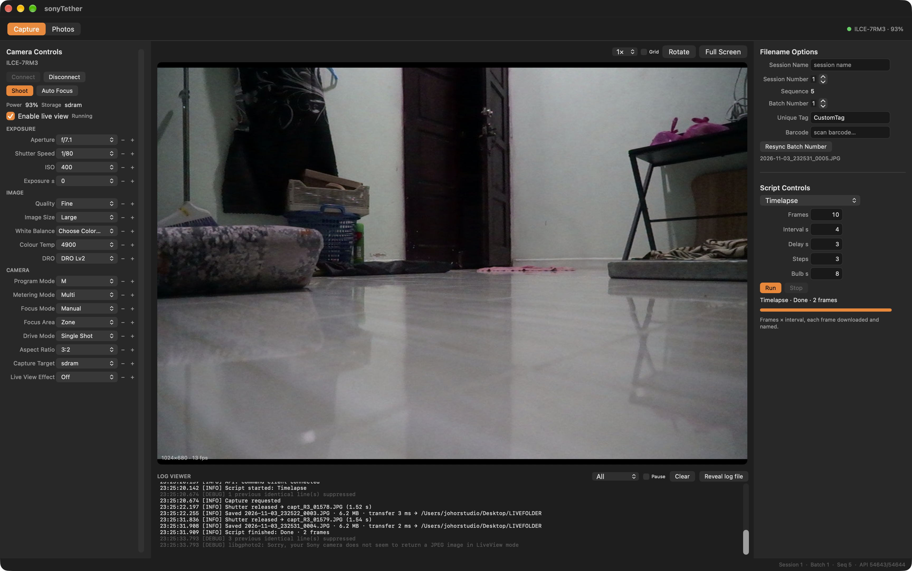
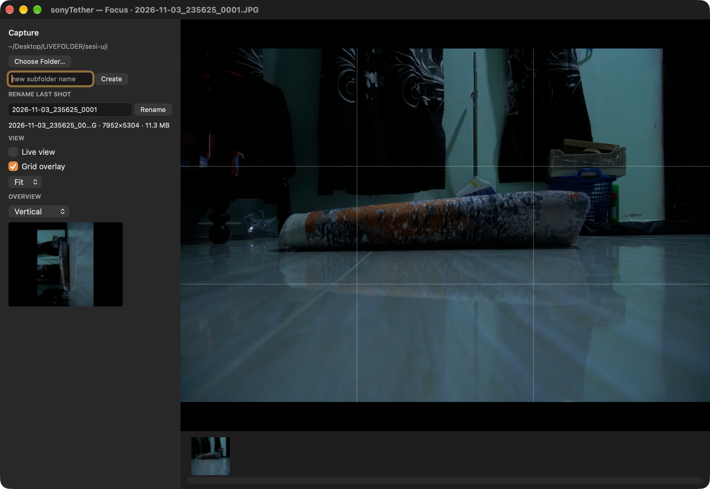

# sonyTether

A native macOS tethering app for Sony bodies over USB PTP, built for the
**a7R III** (ILCE-7RM3 / 7RM3A). Version 0.2.0 is a Smart Shooter-style studio
tool: tabs, live view, the full camera control panel, session naming with a
filename expression language, built-in scripts, a log viewer, a local JSON API
and a Lightroom Classic plug-in.



| | |
|---|---|
| **Capture / Photos tabs** | live view with grid, rotate, zoom; the photo table with session, batch and metadata columns |
| **Camera controls** | aperture, shutter, ISO, exposure ±, quality, image size, WB, colour temperature, DRO, program, metering, focus mode, focus area, drive mode, aspect, capture target, live view effect |
| **Session naming** | Smart Shooter-compatible expression tokens, live preview, session/batch/sequence counters, unique tag, barcode |
| **Scripts** | timelapse and delayed trigger (shipped), brackets/HDR parked — see the note below |
| **Log viewer** | every gphoto2 call, level filter, pause, reveal log file |
| **Global shortcut** | ⌃⌥C by default, keyboard chord or extra mouse button, fires while the app is in the background |
| **Tabs** | Capture · Photos · Shortcuts · ADB · Sync |
| **Focus window** | Display → New Display Window: full-size last shot for focus checking, grid overlay, live-view toggle, panorama/rotation overview, photo strip, rename the last shot, create a new capture subfolder |
| **Transfer** | ADB push to an Android device and/or copy every capture into a sync folder (NAS / backup) |
| **External API** | JSON lines over TCP — events on 54643, commands on 54644 |
| **Lightroom Classic** | bundled `sonyTether.lrplugin` imports the session from the capture manifest |

Version 0.2.0 · macOS 26+ · Apple silicon · app code MIT, libgphoto2 LGPL-2.1.

---

## Install

1. Grab `sonyTether-0.2.0.dmg` from [Releases](https://github.com/RafieRosliputra/sony-tether-mac-app/releases).
2. Drag **sonyTether** into Applications.
3. First launch: the app is ad-hoc signed, not notarized — right-click → **Open**, or
   `xattr -dr com.apple.quarantine /Applications/sonyTether.app`.
4. Camera: **Menu → Setup → USB → USB Connection → PC Remote**, camera on, USB
   cable in the body. Close Imaging Edge, Lightroom, Smart Shooter and Photos.

**macOS 26+ on Apple silicon only** (the bundled libgphoto2 is a Homebrew build
for macOS 26/27, arm64).

### If the camera is not detected

The log (`Display → Toggle Log Viewer`) tells you which case you are in:

- `USB: no Sony device on the bus at all` → cable / port / camera off.
- `USB: Sony device present (054c:0c33 …) but libgphoto2 did not claim it` → the
  USB mode is not PC Remote, or another app owns the PTP interface.
- `macOS Image Capture daemon was holding the camera — released it` → the app
  evicts `ptpcamerad` automatically and retries.
- `Camera stopped responding during capture` → the body froze mid-transfer.
  Power-cycle the camera (off/on) and press Connect. See the capture pacing
  note below.

---

## Capture pacing (important on the a7R III)

The a7R III speaks the older Sony PTP dialect. It takes roughly 1.5 s to
release a frame and it hangs if a second shutter command arrives while it is
still writing. The app therefore:

- pauses live view for the whole capture and during scripts,
- enforces a **6 s minimum gap** between shutter releases,
- polls the body (`gp_camera_get_config`) until it answers before each shot,
- keeps `capturetarget` at the body's own default (SDRAM); forcing `card+sdram`
  made transfers slower and hung more often in testing.

Timelapse intervals below 6 s are therefore effectively 6 s.

---

## Filename expression

Preferences → **Name Policy**. Tokens:

| Token | Meaning | Token | Meaning |
|---|---|---|---|
| `[N]` | session name | `[D]` | date `2026-11-03` |
| `[I]` | session number | `[T]` | time `HHmmss` |
| `[S]` | sequence | `[M]` | milliseconds |
| `[B]` | batch | `[X]` | camera serial |
| `[C]` | camera name | `[o]` | original camera file name |
| `[A]` | app / node name | `[E]` | extension |
| `[U]` | unique tag | `[G]` | camera group |
| `[Z]` | barcode | | |

Width suffix pads with zeros: `[S4]` → `0042`. A `/` creates a subfolder:
`[N]/[S4].[E]` → `luar/0042.JPG`. Default: `[D]_[T]_[S4].[E]`.

Every capture is also appended to `sonyTether-captures.jsonl` in the download
folder — that is what the Lightroom plug-in reads.

---

## External API

Preferences → **External API** (off by default).

```bash
# events (server pushes JSON lines)
nc 127.0.0.1 54643

# commands (one JSON line in, one out)
echo '{"cmd":"status"}'  | nc 127.0.0.1 54644
echo '{"cmd":"capture"}' | nc 127.0.0.1 54644
echo '{"cmd":"set","name":"iso","value":"800"}' | nc 127.0.0.1 54644
echo '{"cmd":"controls"}' | nc 127.0.0.1 54644
echo '{"cmd":"session","name":"luar","number":2,"batch":7,"tag":"TAG1"}' | nc 127.0.0.1 54644
echo '{"cmd":"script","name":"Timelapse","count":20,"interval":6}' | nc 127.0.0.1 54644
```

Events: `hello`, `connected`, `disconnected`, `photo`, `script`.

---

## Lightroom Classic plug-in

`lightroom/sonyTether.lrplugin` is bundled inside the app
(`Contents/Resources/lightroom/`).

1. Lightroom → **File → Plug-in Manager → Add**, pick that folder.
2. **Library → Plug-in Extras → sonyTether**:
   - *Import session photos* — adds every capture listed in
     `sonyTether-captures.jsonl` to the catalog, skips duplicates.
   - *Choose session folder…* — points the plug-in at a download folder.
   - *Session status* — count of captures in the manifest.

---

## Focus window

`Display → New Display Window` (⇧⌘N) opens a second window you can drag to
another display:

- **big view** — the last photo, scroll to zoom (1×–8×), drag to pan, rule of
  thirds overlay (toggle). Click **Live view** to swap it for the live feed.
- **bottom strip** — every capture in the session, click to load one.
- **overview** — small copy of the frame, `Auto / Horizontal / Vertical`
  (Vertical rotates 90° for checking a portrait crop).
- **transfer panel** — ADB and Sync indicator dots (grey = off, red = failing,
  green = OK) with the last few transfer lines.
- **Capture panel** — current folder, *Choose Folder…*, create a new subfolder
  by name (it becomes the download folder), the last shot's size and
  dimensions, and a rename field for the shot you just took.



## Tabs

**Shortcuts** — a table of every menu action with its key; select a row, *Set…*
records a new chord, *Clear* removes it, *Reset All* restores defaults. The
global capture trigger (⌃⌥C, background) stays separate.

**ADB** — enable/pause auto-push, adb binary, device serial, target folder,
wireless connect (host:port), kill/start server, gallery package with
open/restart, delete all photos on the device (with confirmation), and an
optional **auto restart** of the app every N minutes (default 5).

**Sync** — enable, folder, keep subfolder structure, Sync All Now, reveal.

## Folder navigation in the focus window

The folder row shows **← Back** and a button with the current folder name.
Creating a new subfolder enters it and keeps the previous one on the stack, so
Back always returns to the session folder. Clicking the folder button opens the
folder chooser.

## ADB + folder sync

Preferences → **Transfer**:

- **ADB** — enable, set the `adb` path (`/opt/homebrew/bin/adb`), optional
  device serial (blank = first device) and the target folder on the phone
  (`/sdcard/DCIM/sonyTether`). Every capture is pushed right after download;
  failures are logged, a missing device does not block capture.
- **Folder sync** — enable and pick a folder (a mounted NAS, `client-1month`,
  `storage`, or any local backup). Each capture is copied there, preserving the
  session subfolder.
- Transfer menu: *Sync All Now*, *ADB Push Last Photo*, *ADB Devices*.

## Scripts

Shipped: **Timelapse** (frames × interval, each downloaded and named) and
**Delayed trigger**.

**Parked in 0.2.0:** aperture/shutter/ISO bracket and HDR. Changing a setting
between frames hangs the a7R III's PTP stack in testing; the next version will
drive the camera's own bracket drive mode (`capturemode` / `dro`) instead of
rewriting properties between shots. The code is still in the source behind
`ScriptKind.shipped`.

---

## Build from source

```bash
brew install libgphoto2
./build.sh                 # app + dist/*.dmg + dist/*.zip
./build.sh app             # app bundle only
build/sonyTether.app/Contents/MacOS/sonyTether --selftest
build/sonyTether.app/Contents/MacOS/sonyTether --probe    # camera handshake
```

`--selftest` checks the bundle without a camera: camlibs (2467 models incl.
`Sony ILCE-7RM3A (PC Control)`), iolibs, name policy, file writing, folder
writable.

---

## Layout

```
Sources/
  Model.swift            preferences, session state, filename expressions
  CameraService.swift    libgphoto2: controls, capture, preview, scripts, watchdog
  CameraControlsView     left panel
  Panels.swift           filename panel, script panel, photo table, log pane
  MainViewController2    tabs, layout, live view canvas, API dispatch
  PreferencesWindow      General / Name Policy / Barcode / External API / Lightroom
  ExternalAPI.swift      JSON lines over TCP
  HotKey.swift           global capture trigger
  USBBus.swift           IOKit USB probe used by the diagnostics
lightroom/sonyTether.lrplugin/   Lightroom Classic plug-in
tools/icon.swift                 icon generator
```

---

## What was tested (0.2.0)

On an ILCE-7RM3, firmware 3.0, macOS 27.2 arm64, with the camera connected:

- connect, live view 1024×680 at 10–13 fps
- paced captures, sequence `0001 → 0004`, 7952×5304 JPEG ≈ 6 MB each
- timelapse 2 frames at 8 s — completed, status "Done · 2 frames"
- API: `status`, `set iso=400`, `capture`, `script`
- Photos tab lists every capture with camera metadata (aperture, shutter, ISO, size, tag, bytes)
- `ptpcamerad` eviction on the first connect after a cable replug
- watchdog reports `Camera stopped responding during capture` instead of
  pretending the camera is absent

Not verified: Lightroom plug-in inside Lightroom Classic, brackets (parked),
bulb exposures, PTP/IP, other bodies.

---

## Licensing

App code MIT (`LICENSE`). Bundled unmodified LGPL libraries: libgphoto2,
libgphoto2_port, libexif, libltdl, libusb, libintl, libjpeg-turbo. No GPL code
was copied; `Aya0wind/photographer` (GPL-3.0) was read for the
`CAMLIBS`/`IOLIBS` relocation note, and Smart Shooter 4 was studied as a
commercial reference for the feature set only.
