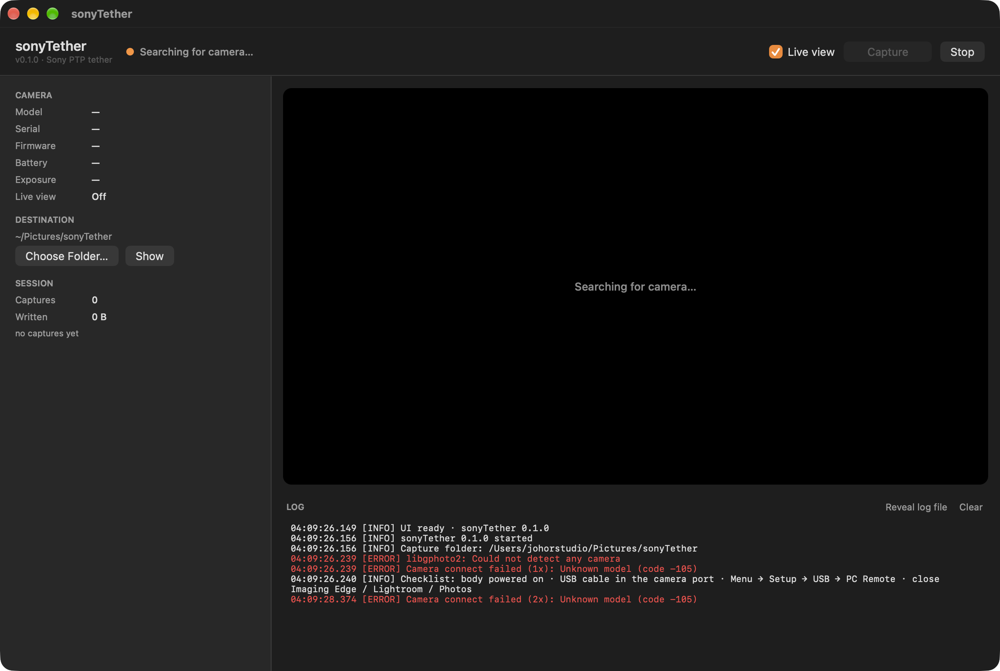

# sonyTether

A native macOS tethering app for Sony bodies over USB PTP — built for the
**a7R III** (ILCE-7RM3 / ILCE-7RM3A), works with any Sony body that speaks
PTP in **PC Remote** mode.



| | |
|---|---|
| **Live view** | JPEG preview straight from the sensor, adaptive frame pacing, fps + resolution readout |
| **Connection status** | green/orange/red pill, model / serial / firmware / battery / exposure, auto-retry every 2 s |
| **Capture** | shutter release from the app, download to the folder of your choice, never overwrites |
| **Auto-download** | shots taken with the camera's own shutter button are picked up from PTP events |
| **Global shortcut** | set a keyboard chord or an extra mouse button (middle/back/forward) that captures even when the app is in the background |
| **Log** | every gphoto2 call/error in the window, also appended to `~/Library/Logs/sonyTether/sonyTether.log` |
| **Folder** | native `NSOpenPanel`, remembered across launches (`~/Pictures/sonyTether` by default) |

Version 0.1.3 · macOS 26+ · Apple silicon · app code MIT, libgphoto2 LGPL-2.1.

---

## Install (download)

1. Grab `sonyTether-0.1.3.dmg` from [Releases](https://github.com/RafieRosliputra/sony-tether-mac-app/releases).
2. Open the DMG, drag **sonyTether** into **Applications**.
3. First launch: the app is **ad-hoc signed, not notarized**. Either
   right-click → **Open**, or clear the download flag once:

   ```bash
   xattr -dr com.apple.quarantine /Applications/sonyTether.app
   ```

4. Put the body in **PC Remote** mode:
   **Menu → Setup → USB → USB Connection → PC Remote**.
   Cable in the camera's USB port (not a hub if you can avoid it), camera on.
5. Close Imaging Edge / Lightroom / Photos — they grab the PTP device first.

The app connects on launch. Header turns green with the model name when the
body answers; live view starts automatically.

> **macOS 26+ / Apple silicon only.** The bundled libgphoto2 is a Homebrew
> build with a 26.0/27.0 minimum, and the app is arm64. Intel and older macOS
> are not supported by this build.

---

## Build from source

```bash
brew install libgphoto2          # build-time only, the app bundles its own copy
./build.sh                       # → build/sonyTether.app, dist/*.dmg, dist/*.zip
./build.sh app                   # app bundle only
open build/sonyTether.app        # run it
```

`build.sh` compiles with `swiftc` (no Xcode project), copies the resolved
libgphoto2 dependency closure into `Contents/Frameworks`, bundles the `ptp2`
camera driver + `usb1` I/O plugin, rewrites install names to
`@executable_path/../Frameworks`, signs ad-hoc, then produces the DMG and ZIP.

### Self test (no camera needed)

```bash
build/sonyTether.app/Contents/MacOS/sonyTether --selftest
```

It proves the bundle is complete: libgphoto2 loads from `Contents/Frameworks`,
the bundled `ptp2.so` registers **2467 camera models**, the `usb1` I/O plugin
loads, the ability to write capture files works. `RESULT: PASS` exits 0.

---

## How it works

```
main.swift            AppKit entry point, menus, About, --selftest
CameraService.swift   libgphoto2 wrapper: open/retry, summary, config widgets,
                      preview frames, capture + download, PTP event loop
MainViewController    window, sidebar status, live view, log pane, folder picker
Logger.swift          UI + file log with 15 s duplicate suppression, 5 MB rotation
Support.swift         C-string helpers, error formatting
Screenshots           docs/
```

One serial `DispatchQueue` owns the `GPContext`/`Camera`, so libgphoto2 is
never called concurrently. The worker ticks:

- drain PTP events (`gp_camera_wait_for_event`, 0 ms) → on `FILE_ADDED`,
  download (this is also what flushes a just-shot image out of the body's
  buffer; see [libgphoto2#966](https://github.com/gphoto/libgphoto2/issues/966))
- if live view is on, `gp_camera_capture_preview` with adaptive pacing
  (~10 fps targeted, backs off to 3 fps if the body is slow)
- refresh battery/exposure from the config tree every 3 s
- repaint status every second while previewing

Capture is `gp_camera_capture` (libgphoto2's Sony path drives PTP
`0xd2c1` ShutterRelease) then `gp_camera_file_get` for the full file. Files
never overwrite: `DSC01234.ARW` → `DSC01234-1.ARW`.

The a7R III reports `Sony Capture` in its PTP capabilities and **no file
deletion**, which is why there is no delete button and why capture works in
~2 s steps rather than instantly.

---

## Status: tested on a real a7R III

Verified on this machine (macOS 27.2 arm64, libgphoto2 2.5.34) with a Sony
**ILCE-7RM3** over USB, PC Remote mode:

- connected as `Sony Alpha-A7r III (PC Control)`; serial + firmware 3.0 read
- **live view**: 1024×680 JPEG frames at ~9 fps, 143–153 KB per frame
- **capture**: shutter released in 2.0–3.1 s, 22–24 MB JPEG saved in ~20 ms,
  card and folder in sync; `capt_R3_0000x.JPG` → `capt_R3_0000x-1.JPG` on repeat
- **battery / exposure** read from the config tree (97%, ISO 200 · 1/100 · …)
- **global shortcut**: ⌃⌥C captured a frame with Finder in front (app in the
  background); recorded and re-armed ⇧⌘K through the in-app recorder
- no ERROR lines in a 5-capture session; the Sony "no JPEG in LiveView"
  hiccup right after a shot is retried silently (debug log only) and live view
  resumes

Headless checks that still run without a camera:

- `--selftest` — bundled camlibs (2467 models incl. `Sony ILCE-7RM3A (PC
  Control)`), iolibs, capture-file writing, folder writable, USB bus count
- `codesign --verify --deep --strict`
- app launches from a copy carrying a Safari-style quarantine flag (App
  Translocation), no crash. Gatekeeper assessment is disabled on this machine,
  so the right-click-Open flow itself was not exercised.

Still untested: other Sony bodies, RAW (ARW) downloads on this firmware,
PTP/IP, and the mouse-button trigger (the keyboard branch is the tested one).

Known limits:

- one camera per process, USB only (PTP/IP plugin is bundled but unused)
- RAW+JPEG: one file per capture (libgphoto2 returns the primary object)
- no delete, no in-app settings editor (ISO/shutter/aperture are read-only here)
- live view pauses ~0.2 s after each capture (body re-arms the preview object)
- ad-hoc signature → not notarized, Gatekeeper needs one right-click
- arm64, macOS 26+

---

## Licensing

- **This app**: MIT (see `LICENSE`).
- **libgphoto2** / **libgphoto2_port**: LGPL-2.1-or-later, shipped as
  unmodified dylibs in `Contents/Frameworks` next to the app. They are
  dynamically linked and replaceable, which is what the LGPL requires for a
  closed or open app that merely uses them. Sources: <https://github.com/gphoto/libgphoto2>.
- **libexif** (LGPL-2.1), **libltdl** (LGPL-2.1), **libusb** (LGPL-2.1),
  **libintl** (LGPL-2.1), **libjpeg-turbo** (IJG/BSD) — same rule, bundled
  unmodified.
- No code was copied from GPL projects. [`Aya0wind/photographer`](https://github.com/Aya0wind/photographer)
  (GPL-3.0) and the existing `sony-tether` web app were read for API notes
  only.

## Prior art that informed this

| Project | License | Use |
|---|---|---|
| [gphoto/libgphoto2](https://github.com/gphoto/libgphoto2) | LGPL-2.1 | the PTP layer; Sony preview/capture paths read at source level |
| [jim-easterbrook/python-gphoto2](https://github.com/jim-easterbrook/python-gphoto2) | LGPL-3.0 | confirmed the config-widget names used by the status panel through the earlier `sony-tether` prototype |
| [photobooth-app/photobooth-app](https://github.com/photobooth-app/photobooth-app) | MIT | reference for a tether session loop |
| [Aya0wind/photographer](https://github.com/Aya0wind/photographer) | GPL-3.0 | documented the `CAMLIBS`/`IOLIBS` relocation and Sony property read-back delay (read, not copied) |
